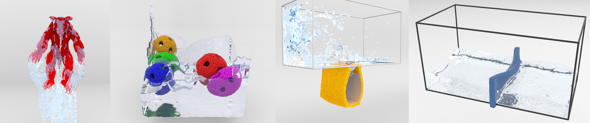

# DIQ-MPM

Official code for **DIQ-MPM: Dual Interface Quadrature MPM for Simulating Large
Deformation and Fluid-Solid Coupling**.

**Kangrui Zhang, Ruihong Cen, Siyan Zhu, Ruoyan Chen, and Bo Ren**

DIQ-MPM couples total Lagrangian MPM solids with Eulerian incompressible fluids.
Dual interface quadrature connects the current and reference configurations in
a monolithic mixed velocity-pressure formulation, enabling large solid
deformations and free-slip fluid-solid coupling.

This codebase was developed from a fork of
[ziran2020](https://github.com/penn-graphics-research/ziran2020). The public
release has been extensively refactored, modernized, and rebuilt with the
assistance of **OpenAI Codex**. It supports both **CPU execution** and a
**CUDA GPU backend**.



*Original paper teaser (Fig. 1). From left to right: Armadillo bath, Balls,
Bag, and Wall. The five examples included in this code release are listed below.*

## Supported examples

The names below follow the figure captions in the DIQ-MPM paper.

| # | Paper example | Description | Command-line selection | Paper figure |
|---:|---|---|---|---|
| 1 | **Armadillo bath** | Water is poured onto an armadillo whose head is fixed in the air, and slides along its deforming surface. Fluid injection starts at frame 15. | `coupling -test 1` | Fig. 4 |
| 2 | **Bag** | After a dam break, water falls through an opening into a hanging elastic bag, stretching the bag as it fills. | `coupling -test 2` | Fig. 5 |
| 3 | **Wall** | A dam-break flow strikes and deforms a vertical elastic wall. The bundled configuration uses the 100x GHOST contact penalty. | `coupling -test 3` | Fig. 7 |
| 4 | **Bear** | A toy bear drops into still water, demonstrating buoyancy and two-way fluid-solid coupling. | `coupling -test 4` | Fig. 6 |
| 5 | **Colliding** | Three armadillos fall under gravity and collide with one another in a standalone solid simulation. | `splitting -test 1` | Fig. 3 |

The executables have separate example numbering: coupling uses 1-4 and
splitting uses 1. Before renumbering, these coupling examples used IDs `7`,
`4003`, `5001`, and `9002`; the splitting example used `8001`. Historical IDs
are no longer accepted as command-line aliases.

This release builds the 3D double-precision simulation only. Legacy 2D and
single-precision simulation instantiations, plasticity models, unused scene
generators/importers, and the empty plugin framework have been removed. The
CPU reference and numerical regression fixtures remain available.

## CPU and GPU implementation

The supported 3D GPU coupling path includes sparse-grid and coupled-system
assembly, AMGX pressure solves, fluid Q1 and solid Q2 transfers, PD/Corotated
solid implicit solves, and the position corrector. In the four coupling
examples, particle state remains on the device between substeps.
Initialization, scheduling, file output, and general fallback paths use the CPU.

Use `-gpu_full_pipeline` for production GPU runs. In the four coupling examples
above, this also enables assertions that stop the run if a supported numerical
stage falls back to the CPU. The standalone Colliding example uses GPU assembly
and solves but retains host particle writeback boundaries; see its
[interface guide](docs/gpu_splitting_vp_interface.md).

See [validation coverage](docs/gpu_coupling_acceptance_report.md) for the
distinction between local operator checks, short state comparisons, and
historical long runs.

## Source layout

The CPU reference and GPU version share scene construction, particle attributes,
material/contact definitions, restart files, and the MPM interfaces. Build each
backend in its own directory; GPU runs enable the CUDA numerical pipeline with
`-gpu_full_pipeline`.

| Location | Responsibility |
|---|---|
| `Lib/Ziran/` | Shared data structures, math, geometry, constitutive models, solvers, logging, and time stepping |
| `Lib/MPM/Grid/` | Sparse MPM grid and activation of particle support pages |
| `Lib/MPM/Simulation/` | Shared MPM time step, particle/grid transfers, implicit-step setup, and energy diagnostics |
| `Lib/MPM/Initialization/` | Particle sampling, material assignment, rest positions, and pinning/contact setup |
| `Lib/MPM/Force/` | Assembly of material, pinning, and Lagrangian contact force terms |
| `Lib/MPM/instantiations/` | Compiled 3D double-precision template instantiations for the `mpm_core` library |
| `Projects/coupling/` | Four fluid/solid examples, the coupling solve, position corrector, and shared CUDA kernels |
| `Projects/splitting/` | Standalone solid collision example and the single-phase VP driver shared by coupling |

MPM template method definitions live in `.tpp` files, included by their explicit
instantiation `.cpp` files. `MpmForceAssembly` combines force terms;
`MpmParticleRange` assigns state and constraints to a particle subset;
`MpmSceneInitializer` samples particles and registers colliders. In the mixed
material interface, F is the deformation gradient and J is the volume ratio.
Checkpoint attribute keys and their serialized field order are preserved.

## Requirements

The tested platform is Linux x86-64 with an NVIDIA RTX 4080, CUDA 12.2,
GCC 11 as the CUDA host compiler, Eigen 5, oneTBB 2023, OpenVDB 11,
METIS 5, and Boost 1.84. CPU compilation uses the conda compiler wrappers.
The default GPU architecture is 89; override `CMAKE_CUDA_ARCHITECTURES` for
another target. Other GPU architectures have not been validated here.

Keep GPU and CPU environments separate. [CUDA/AMGX setup](docs/amgx_cuda12_setup.md)
describes the GPU dependencies, including the pinned AMGX and NVTX versions.

## Get the source

```bash
git clone https://github.com/KangruiZ/DIQ-MPM.git
cd DIQ-MPM
```

## Data

Download the original [IQ-MPM data archive](https://drive.google.com/file/d/1f22ObJmiq8H1_YObTz5BuE4IAWLQhyuB/view?usp=sharing)
and extract it so this checkout contains `Data/MpmParticles`, `Data/LevelSets`,
and the other data subdirectories. Data and generated simulation output are
not included in the source tree.

Always run simulations from the repository root. Data locations are recorded
during configuration; reconfigure after relocating a checkout.

## Build the GPU version

After preparing `ziran-cuda12` and building AMGX as described in the setup guide,
activate that environment in your terminal and configure:

```bash
conda activate ziran-cuda12

cmake -S . -B build-ziran-cuda12 -G Ninja \
  -DCMAKE_BUILD_TYPE=Release \
  -DENABLE_AMGCL_CUDA=ON \
  -DENABLE_CUDA_STAGE2_PROBE=ON \
  -DENABLE_CUSPARSE_SPGEMM=ON \
  -DENABLE_AMGX=ON \
  -DAMGX_ROOT="$PWD/../AMGX" \
  -DAMGX_LIBRARY="$PWD/../AMGX/build-ziran-cuda12/libamgxsh.so" \
  -DCMAKE_CUDA_ARCHITECTURES=89 \
  -DCMAKE_CUDA_COMPILER="$CONDA_PREFIX/bin/nvcc" \
  -DCUDAToolkit_ROOT="$CONDA_PREFIX" \
  -DCMAKE_CUDA_HOST_COMPILER=/usr/bin/g++-11 \
  -DZIRAN_VEXCL_NVCC_OPTIONS="-O3 -ccbin /usr/bin/g++-11"

conda run -n ziran-cuda12 cmake --build build-ziran-cuda12 \
  --target coupling splitting -j 4
```

`ENABLE_CUDA_STAGE2_PROBE` is the historical name of the option enabling the
production CUDA kernels. It is required even when no diagnostic probes are used.
AMGCL and VexCL are fetched at pinned commits; the remaining source dependencies
are also pinned. The first configuration needs network access.

Executables are written inside their build directory, so GPU and CPU builds
can coexist without overwriting each other.

## Run and restart

A one-frame GPU smoke run:

```bash
conda run -n ziran-cuda12 --no-capture-output \
  build-ziran-cuda12/Projects/coupling/coupling \
  -test 4 -max_frame 1 -gpu_full_pipeline -t 4 \
  -output_dir output/coupling/4_smoke
```

A longer run and a continuation from its checkpoint:

```bash
conda run -n ziran-cuda12 --no-capture-output \
  build-ziran-cuda12/Projects/coupling/coupling \
  -test 2 -max_frame 100 -gpu_full_pipeline -restart_interval 20 -t 4 \
  -output_dir output/coupling/2_dam_break_with_bag

conda run -n ziran-cuda12 --no-capture-output \
  build-ziran-cuda12/Projects/coupling/coupling \
  -test 2 -restart 100 -max_frame 140 -gpu_full_pipeline -t 4 \
  -output_dir output/coupling/2_dam_break_with_bag
```

Restart requires the matching checkpoints for both materials. Visualization
files are written every frame; checkpoints are written every 20 frames by
default. Reusing an output directory can overwrite an earlier run.

See the [coupling interface](docs/gpu_coupling_interface.md) for flags and
supported model/contact combinations, and the
[splitting interface](docs/gpu_splitting_vp_interface.md) for the collision example (`splitting -test 1`).

## Tests

```bash
conda run -n ziran-cuda12 cmake --build build-ziran-cuda12 \
  --target stage2_gpu_sparse_grid_probe_test stage3_gpu_operator_probe_test \
           solid_implicit_gpu_operator_test cusparse_spgemm_smoke_test -j 4
conda run -n ziran-cuda12 ctest --test-dir build-ziran-cuda12 --output-on-failure
```

These fixtures cover sparse-grid ordering/scatter, sparse operators and CSR
products, PD/Corotated constitutive tangents, device Newton/PCG and contact,
and cuSPARSE SpGEMM. Simulation data is not needed for these fixtures.
Use `-DBUILD_TESTING=OFF` to omit test targets in an application-only build.

## CPU reference

```bash
conda create -n ziran-dev -c conda-forge \
  python=3.12 cmake ninja make git gcc_linux-64 gxx_linux-64 \
  eigen tbb-devel openvdb=11 metis boost-cpp libboost-devel zlib bzip2

conda run -n ziran-dev cmake -S . -B build-ziran-dev -G Ninja \
  -DCMAKE_BUILD_TYPE=Release -DENABLE_AMGCL_CUDA=OFF \
  -DENABLE_CUDA_STAGE2_PROBE=OFF -DENABLE_AMGX=OFF
conda run -n ziran-dev cmake --build build-ziran-dev --target coupling splitting -j 4

conda run -n ziran-dev --no-capture-output \
  build-ziran-dev/Projects/coupling/coupling \
  -test 4 -max_frame 2 -solver amgcl -t 4 \
  -output_dir output/coupling/4_cpu
```

A CUDA executable with only `-solver amgcl` is not a complete CPU reference.
Compare particle states from the same initial state or checkpoint, with fixed
solver settings; binary output files need not be byte-identical.

## Acknowledgments

This project builds on [ziran2020](https://github.com/penn-graphics-research/ziran2020)
and the original **IQ-MPM: An Interface Quadrature Material Point Method for
Non-sticky Strongly Two-way Coupled Nonlinear Solids and Fluids** by
Yu Fang, Ziyin Qu, Minchen Li, Xinxin Zhang, Yixin Zhu, Mridul Aanjaneya,
and Chenfanfu Jiang (SIGGRAPH 2020). We thank the original authors for making
their implementation available.
